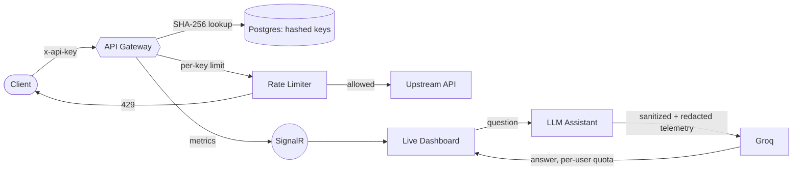
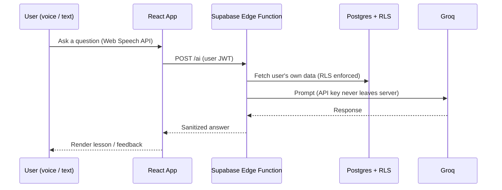
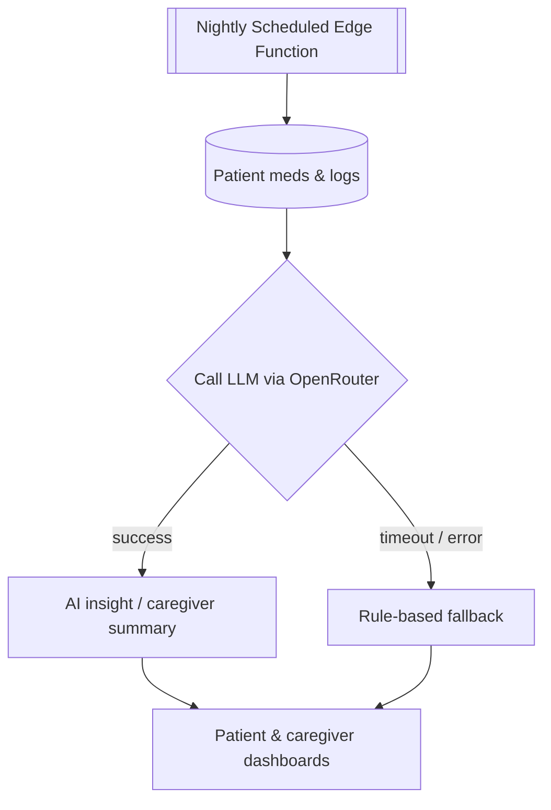
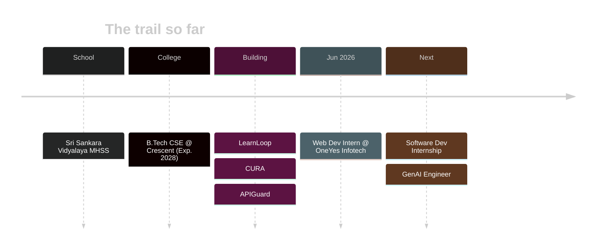

<!-- ================= HERO BANNER ================= -->


<p align="center">
  
</p>

<p align="center">
  <a href="https://shivasaran.vercel.app/"></a>
  <a href="https://github.com/saran-77"></a>
  
  
  <a href="https://github.com/saran-77?tab=followers"></a>
</p>

<!-- ================= NAV BAR ================= -->
<p align="center">
  <a href="#whoami"><b>whoami</b></a> ·
  <a href="#projects"><b>projects</b></a> ·
  <a href="#skills"><b>skills</b></a> ·
  <a href="#stats"><b>stats</b></a> ·
  <a href="#experience"><b>experience</b></a> ·
  <a href="#education"><b>education</b></a> ·
  <a href="#contact"><b>contact</b></a>
</p>


<!-- ================= WHOAMI ================= -->
<a name="whoami"></a>

 whoami" />

<table>
<tr>
<td width="62%" valign="top">

```ruby
$ cat shiva.profile

  NAME        :: Shiva Saran
  ROLE        :: Full Stack & Generative AI Developer
  EDUCATION   :: B.Tech CSE @ Abdur Rahman Crescent Institute (Exp. 2028)
  FOCUS       :: Secure, reliable AI features in real products
  SUPERPOWER  :: API keys server-side, data sanitized, graceful fallbacks
  LOCATION    :: Chennai, India
  MISSION     :: Land a software dev internship, grow into a GenAI Engineer
```

</td>
<td width="38%" valign="middle" align="center">


</td>
</tr>
</table>

> I build web and mobile apps and integrate LLMs into real products, with a focus on **security, data sanitization and graceful fallbacks**.

<details>
<summary><b>Click to run <code>./fun-facts.sh</code></b></summary>
<br>

```bash
$ ./fun-facts.sh
[✔] Believes every AI feature needs a plan B (rule-based fallback FTW)
[✔] Treats API keys like toothbrushes: never shared, never client-side
[✔] Reads error logs for fun, then asks an LLM to summarize them
[✔] Currently levelling up: RAG pipelines, evals, agentic workflows
```

</details>


<!-- ================= PROJECTS ================= -->
<a name="projects"></a>

 ls ./projects" />

<table>
<tr>
<td width="50%" valign="top">

### 🛡️ APIGuard
**API Management & Monitoring Platform**

- API gateway with key management, per-key rate limiting and a live analytics dashboard
- API keys stored as **SHA-256 hashes**
- **LLM assistant (Groq)** answers questions about traffic and errors using sanitized, redacted telemetry, with per-user quotas
- xUnit tests, CI pipeline and Docker image


</td>
<td width="50%" valign="top">

### 📚 LearnLoop
**AI-Powered Learning Platform**

- Web and mobile learning app on **Supabase Postgres with Row Level Security**
- LLM features via a **Supabase Edge Function**, keeping the Groq API key server-side
- **Voice input** using the Web Speech API


</td>
</tr>
<tr>
<td colspan="2" valign="top">

### 💊 CURA
**Patient & Caregiver Health Companion**

- Dual-role mobile app for patients and caregivers with **Google OAuth**, role-based access, medication reminders and read-only caregiver dashboards
- **Scheduled Edge Functions** use LLMs to generate nightly insights and on-demand caregiver summaries
- **Rule-based fallback**, so reminders and summaries still work if the AI service fails


</td>
</tr>
</table>

### Under the hood (click to expand)

<details>
<summary><b>APIGuard: request pipeline</b></summary>
<br>



</details>

<details>
<summary><b>LearnLoop: keeping the key server-side</b></summary>
<br>



</details>

<details>
<summary><b>CURA: AI with a safety net</b></summary>
<br>



</details>


<!-- ================= SKILLS ================= -->
<a name="skills"></a>

 cat skills.json" />

<p align="center">
  <a href="https://skillicons.dev">
    
  </a>
</p>

<details open>
<summary><b>LANGUAGES</b></summary>
<p align="center">
  
  
  
  
  
  
  
</p>
</details>

<details>
<summary><b>FRONTEND</b></summary>
<p align="center">
  
  
  
  
  
</p>
</details>

<details>
<summary><b>BACKEND & DATA</b></summary>
<p align="center">
  
  
  
  
  
  
</p>
</details>

<details>
<summary><b>GENERATIVE AI</b></summary>
<p align="center">
  
  
  
  
</p>
</details>

<details>
<summary><b>MACHINE LEARNING</b></summary>
<p align="center">
  
  
  
</p>
</details>

<details>
<summary><b>TOOLS</b></summary>
<p align="center">
  
  
  
  
  
</p>
</details>


<!-- ================= EXPERIENCE ================= -->
<a name="experience"></a>

 git log --experience" />

```diff
+ Web Developer Intern  @ OneYes Infotech Solutions        [Jun 2026 - Jul 2026]
  - Built and maintained responsive web interface components in a dev team
  - Shipped features and fixes through Git-based team workflows
```



<!-- ================= EDUCATION ================= -->
<a name="education"></a>

 cat education.txt" />

```yaml
B.Tech, Computer Science and Engineering:
  institute: Abdur Rahman Crescent Institute of Science and Technology
  expected: 2028
Higher Secondary:
  school: Sri Sankara Vidyalaya Matriculation Higher Secondary School
```


<!-- ================= CONTACT ================= -->
<a name="contact"></a>

 ping shiva" />

```bash
$ ping shiva
PING shiva (chennai.in): 56 data bytes
64 bytes from shiva: icmp_seq=0 ttl=64 time=0.42 ms  [status=open-to-internships]
64 bytes from shiva: icmp_seq=1 ttl=64 time=0.37 ms  [reply=usually-within-24h]
--- shiva ping statistics ---
2 packets transmitted, 2 received, 0% packet loss
```

<p align="center">
  <a href="https://www.linkedin.com/in/shiva-saran-7b3605324">
    
  </a>
  <a href="mailto:shivasaran757@gmail.com">
    
  </a>
  <a href="Yhttps://shivasaran.vercel.app/">
    
  </a>
  <a href="https://github.com/saran-77">
    
  </a>
</p>

<p align="center">
  
</p>

<p align="center"><a href="#whoami">back to top</a></p>


